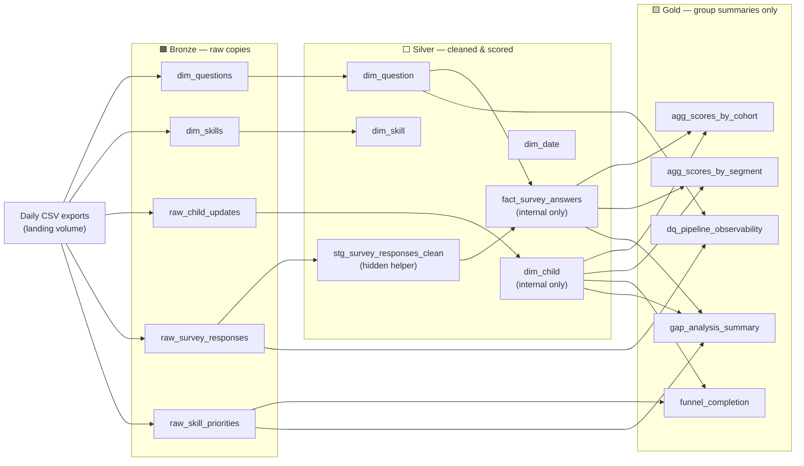

# Medallion Architecture Overview

This document explains, in plain language, what each table in this pipeline does and how the
tables connect to each other. It covers the three layers of the pipeline — **Bronze**, **Silver**,
and **Gold** — in the order data flows through them.

If you want the full technical detail (exact columns, business rules, privacy requirements),
see `AGENTS.md`. This document is the simple map of "what exists and how it connects."

## The big picture

Every day, for 6 months, KindScreen exported 3-4 CSV files with new survey data. Those files
were uploaded into a landing area in Databricks. From there, the pipeline moves the data through
three stages, each one cleaner and more summarized than the last:

- **Bronze** — the raw data, copied in exactly as it arrived (typos, duplicates, and all).
- **Silver** — the same data, cleaned up and scored, still at the level of one row per child.
- **Gold** — group-level summaries only. No individual child ever appears in Gold — every
  number here represents at least 20 children combined.

## A few terms used throughout

- **Grain** — what one row of a table represents (e.g. "one row = one child" vs. "one row = one
  group of children"). Getting this right matters a lot — see `AGENTS.md` for more.
- **Cohort** — all the children who registered in the same month. The dashboard compares cohorts
  to each other over time, never a single child to themselves (each child only takes the survey
  once).
- **The 20-child rule (k-anonymity)** — no Gold table ever shows a number that represents fewer
  than 20 children. If a group would be smaller than that (e.g. "grandmothers in the UK who
  registered in March"), it gets folded into a generic `"other"` bucket instead of being shown on
  its own — this protects any single child from being identifiable.
- **Score / polarity** — every survey answer becomes a number from 0 (a difficulty) to 2 (a
  strength). Some questions are worded as a problem ("does your child worry a lot?"), so their
  scale gets flipped before combining with the rest — that flip is called "polarity."

---

## 🟫 Bronze layer — raw copies

Bronze keeps the data exactly as it arrived, including mistakes. Nothing gets fixed here — that
happens in Silver. Every Bronze table also records when each row was processed and which file it
came from, for troubleshooting.

### `dim_questions`
The list of all 30 survey questions, exactly as they came from the source file — the question
text (English and Spanish), which of the 9 categories it belongs to, and whether it's a
"positive" or "negative" style question. This barely changes; it's a reference list, not
something that grows daily.

### `dim_skills`
The list of the 15 skills a parent can choose to prioritize for their child (e.g. "Patience",
"Kindness"). Also a small, static reference list.

### `raw_child_updates`
One row per child account, for every day new accounts were created. Includes the child's **exact
birth date** — this is the only table in the entire pipeline where the exact birth date is kept.

### `raw_survey_responses`
One row per question answered by a parent — the biggest table, since each child can answer up to
30 questions. This is the table with the known messy data: about 1.5% of answers have typos
(`"Si"` instead of `"si"`), and about 0.3% of rows are exact duplicates. That's intentional — it's
what Silver's cleanup step exists to fix.

### `raw_skill_priorities`
The skills each parent picked and ranked (1st choice, 2nd choice, etc.) for their child. Only
children who answered at least 25 of the 30 questions have rows here — it's a real drop-off point
in the product, not missing data.

---

## ⬜ Silver layer — cleaned, scored, still per-child

Silver is where the actual cleaning and business logic happens. Two tables here
(`dim_child` and `fact_survey_answers`) still have one row per child — that's needed to calculate
things correctly — but neither is ever shown outside this layer. Gold never sees a single child,
only group summaries.

### `dim_question`
The clean version of `dim_questions`, with the internal bookkeeping columns removed. This is the
table every score calculation checks to know a question's category and polarity.

### `dim_skill`
The clean version of `dim_skills`, same idea.

### `dim_child` *(internal only)*
One row per child, with the sensitive part fixed: instead of an exact birth date, each child now
has an **age group** (like `"4-6"` or `"7-9"`) — the exact date is left behind in Bronze and never
carried forward. This table is the source of every demographic detail (region, gender, age group,
relationship to child) used later in Gold — but the table itself, and the exact age, never leave
Silver.

### `dim_date`
A calendar covering the full 6-month period (Feb–Aug 2024), so dates can be grouped cleanly into
months, quarters, or weekends whenever needed.

### `stg_survey_responses_clean` *(hidden helper, not a saved table)*
A quick fix-up step: corrects typos in answers and removes exact duplicate rows. It only exists to
feed directly into `fact_survey_answers` — nothing else reads it, and it's never stored on its
own.

### `fact_survey_answers` *(internal only)*
Every cleaned survey answer, now turned into a score from 0 (difficulty) to 2 (strength) —
this is where the "polarity flip" mentioned above happens. **This is the most important table in
the whole pipeline** — nearly every Gold table is built by summarizing this one.

---

## 🟨 Gold layer — group summaries only

Nothing in Gold can be traced back to a single child. Every table here either groups by month, by
demographic segment, or (for one table) isn't about children at all.

### `agg_scores_by_cohort`
The average score per category (e.g. "how confident do parents feel"), grouped by the month
children registered. This is what powers the trend charts on the dashboard — "did scores improve
between February and August?"

### `agg_scores_by_segment`
Same idea, but grouped by demographics instead of time — region, language, who's filling out the
survey (mom, dad, grandparent...), gender, and age group. Lets you compare groups against each
other.

### `funnel_completion`
How many children registered each month, how many of those actually finished the survey, and how
many went on to pick skill priorities. Shows where people drop off in the product.

### `gap_analysis_summary`
Compares two things per child: the category the survey found to be their **weakest**, versus the
skill the parent **chose to prioritize** for them. Do parents usually pick the right thing to
focus on, or is there a gap between what they notice and what the data shows?

### `dq_pipeline_observability`
The odd one out — this table isn't about children at all, it's about the **health of the pipeline
itself**: how much data came in each day, how much of a backlog had built up by the time it got
processed, and how many rows needed cleaning (duplicates, typos, unrecognized questions). This is
the only Gold table without the 20-child rule, because it's not describing children — it's
describing the pipeline's own data quality.

---

## How the tables connect, at a glance

| This table... | ...is built from | ...to answer |
|---|---|---|
| `dim_question` | `dim_questions` | "What category and polarity does this question have?" |
| `dim_skill` | `dim_skills` | "What is this skill called?" |
| `dim_child` | `raw_child_updates` | "What age group, region, gender is this child?" |
| `fact_survey_answers` | `raw_survey_responses` + `dim_question` | "How did this child score on this question?" |
| `agg_scores_by_cohort` | `fact_survey_answers` + `dim_child` | "How do scores trend by registration month?" |
| `agg_scores_by_segment` | `fact_survey_answers` + `dim_child` | "How do scores differ by demographic group?" |
| `funnel_completion` | `dim_child` + `fact_survey_answers` + `raw_skill_priorities` | "Where do people drop off?" |
| `gap_analysis_summary` | `fact_survey_answers` + `raw_skill_priorities` + `dim_child` | "Does the parent's choice match the data?" |
| `dq_pipeline_observability` | `raw_survey_responses` + `dim_question` | "Is the pipeline itself healthy?" |
